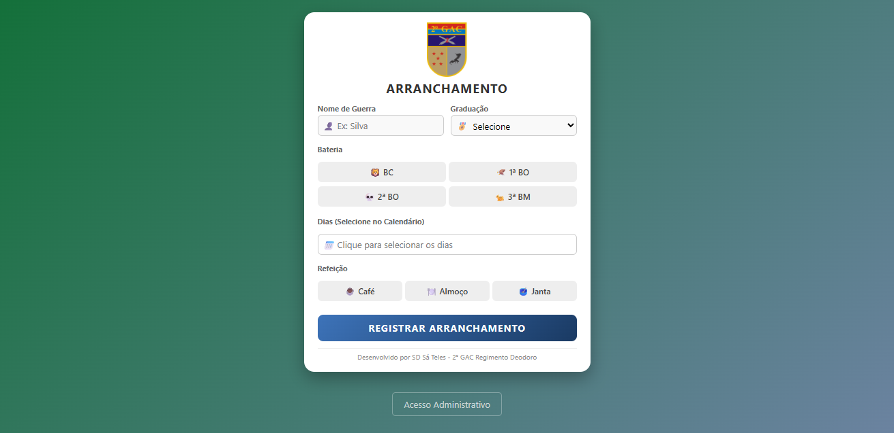
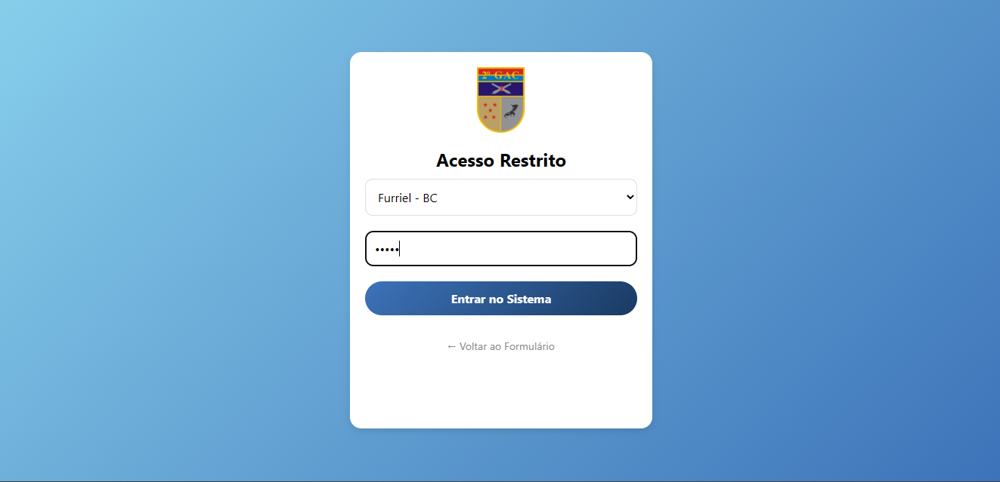
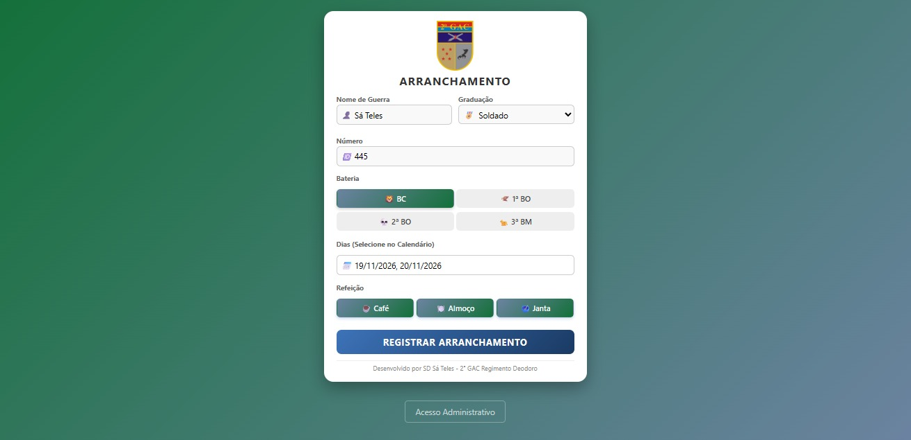
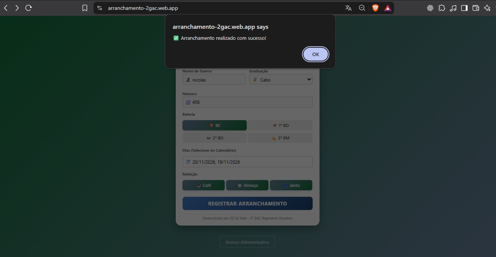
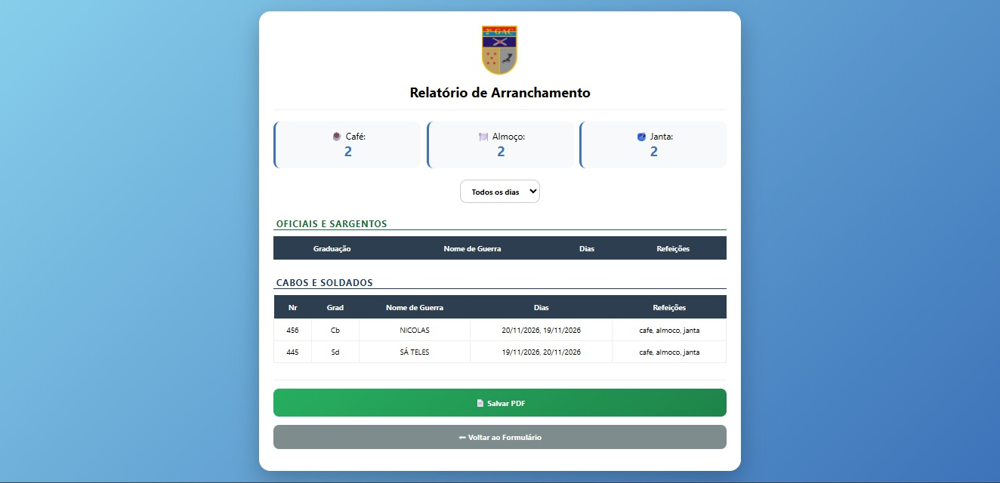
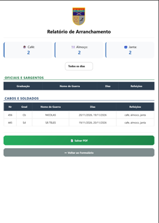

# 📋 Sistema de Arranchamento — 2º GAC

Aplicação web desenvolvida para digitalizar e otimizar o gerenciamento de arranchamento militar, substituindo processos manuais por uma solução com controle de acesso, gerenciamento de registros e geração automatizada de relatórios.

O projeto foi desenvolvido para atender a uma necessidade administrativa real, aplicando conceitos de desenvolvimento web e integração com banco de dados em nuvem.

## 🌐 Aplicação

[**Acessar o Sistema**](https://arranchamento-2gac.web.app/)

## 🚀 Funcionalidades

- **Cadastro de militares:** registro de número, nome, bateria, dias da semana e refeições.
- **Controle de acesso:** diferentes níveis de permissão para Furriéis e Administrador.
- **Gestão por bateria:** gerenciamento independente dos registros de cada subunidade.
- **Gerenciamento de registros:** consulta e cancelamento de solicitações.
- **Relatórios automatizados:** contabilização de café da manhã, almoço e jantar.
- **Exportação em PDF:** geração de relatórios para consulta e impressão.

## 🔐 Controle de acesso

O sistema possui diferentes perfis de utilização, com permissões específicas:

| Perfil | Permissão |
|---|---|
| Furriel BC | Gerenciamento da BC |
| Furriel 1ª BO | Gerenciamento da 1ª BO |
| Furriel 2ª BO | Gerenciamento da 2ª BO |
| Furriel 3ª BM | Gerenciamento da 3ª BM |
| Administrador | Gerenciamento geral do sistema |

*As credenciais de acesso não são disponibilizadas publicamente.*

## 🛠️ Tecnologias utilizadas

- **HTML5:** estrutura da aplicação.
- **CSS3:** estilização e responsividade.
- **JavaScript (ES6+):** lógica de negócio e funcionalidades.
- **Firebase Firestore:** armazenamento e gerenciamento dos dados.
- **Firebase Hosting:** hospedagem e publicação.

## 🖥️ Demonstração

### 1. Tela inicial
Interface principal para cadastro de arranchamento.

### 2. Acesso administrativo
Autenticação dos perfis de gerenciamento.

### 3. Preenchimento de informações
Seleção de dias e refeições para o cadastro.

### 4. Confirmação de cadastro
Retorno de confirmação após o registro.

### 5. Painel de relatórios
Visualização dos quantitativos de refeições e registros.

### 6. Relatório PDF
Exemplo de relatório gerado pela aplicação.

## 🎯 Objetivo e aprendizado

O desenvolvimento deste projeto proporcionou experiência prática na construção de uma aplicação web, incluindo:

- Organização de código HTML, CSS e JavaScript.
- Integração com banco de dados em nuvem utilizando Firebase Firestore.
- Implementação de regras de acesso por perfil.
- Manipulação e gerenciamento de registros.
- Geração de relatórios em PDF.
- Publicação e disponibilização de uma aplicação web.

## 📌 Status

**Aplicação publicada e disponível para acesso.**
